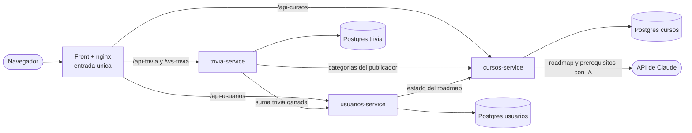

# GrowLink - infra

Aqui vive todo lo que hace falta para correr y desplegar GrowLink completo:
el `docker-compose.yml` para levantar todo en local, los scripts, y la guia
de como se despliega a Azure. El codigo de cada parte esta en su propio repo.

## Como esta armado



Son 3 microservicios, cada uno con su propia base de datos, mas el front. Los
tres validan el mismo JWT, que firma usuarios-service. Los llamados entre
servicios que no vienen de un usuario (trivia avisando una victoria) se
identifican con una llave interna.

| Repo | Que hace |
|---|---|
| `usuarios-service` | Login, perfil, home segun el rol, contador de trivias ganadas |
| `cursos-service` | Cursos, prerequisitos, habilidades, completados y roadmap con IA |
| `trivia-service` | Salas de trivia en tiempo real (WebSocket), preguntas, metricas para el admin |
| `GrowLink-FRONTEND` | La app web, con nginx como entrada unica |
| `infra` | Este repo |

## Ramas y ambientes

Todos los repos tienen las mismas tres ramas. Cada rama se despliega sola a su
propio ambiente, asi se pueden tener desplegadas las tres versiones a la vez, o
desplegar solo la que toque.

| Rama | Ambiente de GitHub | Que es |
|---|---|---|
| `main` | `actual` | Lo que tenemos ahora |
| `avance` | `avance` | El avance intermedio |
| `final` | `final` | La entrega final |

- Cada vez que se sube algo a una de esas ramas, `ci.yml` corre las pruebas y
  `cd.yml` despliega al ambiente de esa rama (si las pruebas pasan).
- `cd.yml` tambien se puede correr a mano desde la pestana Actions
  (workflow_dispatch) para volver a desplegar sin cambiar nada.
- Para pasar una version a la siguiente: `git checkout avance && git merge main`
  y subir. Lo que no se mezcla se queda como esta, asi que `main` nunca cambia
  hasta que alguien decida cambiarlo.

## Correr todo en local

Hace falta Docker. Los repos tienen que estar uno al lado del otro, como estan
en la carpeta `Growlink`.

```bash
cp .env.example .env       # y cambiar los secretos del .env
docker compose up --build
```

Abrir http://localhost:3000 y entrar con uno de los tres usuarios de prueba.

Para construir una version distinta, cambiar de rama en todos los repos a la vez:

```bash
./scripts/cambiar-rama.sh avance
docker compose up --build
```

El script no cambia nada si algun repo tiene cambios sin guardar.

## Desplegar en Azure

Se repite para cada ambiente (`actual`, `avance`, `final`). Servicio recomendado
por el profe: **App Service**, porque ya viene hecho para desplegar y trae el
escalado y el balanceador incluidos.

1. **Grupo de recursos**: `growlink-<ambiente>`.
2. **Base de datos**: un Azure Database for PostgreSQL Flexible Server con tres
   bases: `growlink`, `cursos` y `trivia`. Permitir el acceso desde los
   servicios de Azure.
3. **Plan de App Service** (Linux).
4. **Cuatro Web Apps**:
   - `usuarios`, `cursos` y `trivia`: runtime **Java 21 (Java SE)**.
   - `front`: **contenedor** (la imagen la sube el workflow a GitHub Container
     Registry, `ghcr.io/grow-link/growlink-frontend:<rama>`; mas facil si el
     paquete es publico).
5. **Variables de cada Web App** (Settings > Environment variables), estan en el
   README de cada repo. Las que se repiten:
   - `GROWLINK_JWT_SECRET`: el mismo en las tres.
   - `GROWLINK_INTERNAL_KEY`: la misma en usuarios y trivia.
   - `PORT` y `WEBSITES_PORT`: poner las dos con el puerto del servicio
     (usuarios 8080, cursos 8086, trivia 8085, front solo `WEBSITES_PORT=80`).
   - `CLAUDE_API_KEY` en cursos para el roadmap con IA.
6. **Front**: `USUARIOS_URL`, `CURSOS_URL` y `TRIVIA_URL` con las direcciones
   `https://...azurewebsites.net` de cada servicio, y `DNS_RESOLVER=168.63.129.16`.
7. **trivia**: prender **Web sockets** (Configuration > General settings).
8. **GitHub**: en cada repo, Settings > Environments, crear `actual`, `avance` y
   `final`. En cada ambiente:
   - variable `AZURE_WEBAPP_NAME` con el nombre de la Web App de ese ambiente.
   - secreto `AZURE_WEBAPP_PUBLISH_PROFILE` con el contenido del archivo que se
     baja de la Web App (Overview > Get publish profile).
9. Hacer push a la rama y mirar la pestana Actions.

## Que falta confirmar

Esto se escribio sin tener acceso a una suscripcion de Azure ni a un Docker
corriendo, asi que ni los workflows de despliegue ni el `docker-compose.yml`
completo se han probado de punta a punta. Lo que si esta probado: las pruebas de
cada servicio y que el front compile. Si algo del despliegue falla, lo mas
probable es un nombre de variable o un puerto, y se arregla en la Web App sin
tocar codigo.
