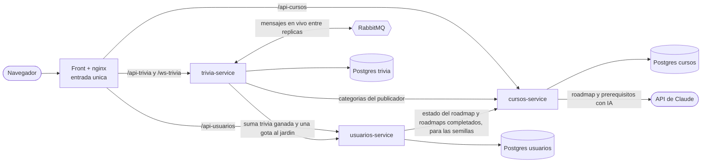

# GrowLink - infra

Aqui vive todo lo que hace falta para correr y desplegar GrowLink completo:
el `docker-compose.yml` para levantar todo en local, los scripts, y la guia
de como se despliega a Azure. El codigo de cada parte esta en su propio repo.

## Si eres nueva en el proyecto (empieza aqui)

1. Clona los cinco repos **en la misma carpeta** (el compose y los scripts esperan que
   esten uno al lado del otro):
   `usuarios-service`, `cursos-service`, `trivia-service`, `GrowLink-FRONTEND` e `infra`,
   todos de la organizacion `Grow-Link` en GitHub. Todo el trabajo esta en la rama `main`.
2. Escoge como correrlo (mas detalle abajo, en "Correr todo en local"):
   - **Sin Docker** (lo mas rapido): `.\infra\scripts\demo-sin-docker.ps1` desde la carpeta
     que contiene los repos. Hace falta Java 21, Maven y Node 22.
   - **Con Docker** (con replicas y balanceo): `cp .env.example .env` y `./scripts/levantar.sh`
     desde Git Bash, dentro de `infra`.
3. Para que el roadmap use la IA de verdad hace falta una llave de la API de Claude
   (ver la siguiente seccion). Sin llave todo funciona igual, pero en modo de respaldo.

### Documentación de arquitectura

- [`docs/atributos-de-calidad.md`](docs/atributos-de-calidad.md): qué atributos de calidad tiene el sistema (disponibilidad,
  escalabilidad, seguridad, rendimiento, observabilidad…), el escenario de cada uno, cómo comprobarlo y qué falta.
- [`docs/adr/`](docs/adr/): las decisiones de arquitectura, una por archivo (por qué microservicios, por qué JWT, por qué la IA
  no manda, etc.).
- [`docs/arquitectura-roadmap-catalogo-publicador.md`](docs/arquitectura-roadmap-catalogo-publicador.md): la parte del roadmap
  y el catálogo, con clases y líneas.

### La llave de Claude

Cada persona que corra el proyecto con IA necesita **una llave de API** (se crea en la consola de
desarrolladores de Anthropic; es un cobro por uso aparte de Claude Pro, con saldo prepagado, y un
roadmap cuesta unos centavos de dolar). Reglas para no tener problemas:

- La llave **nunca va en un archivo que se suba a git**, ni en el codigo, ni en un chat. Si hay que
  compartir una, que sea por un canal privado. Cada una puede crear la suya.
- Donde se pone, segun como corras el proyecto:

| Como lo corres | Donde va la llave |
|---|---|
| Sin Docker (Windows) | Variable de usuario, una sola vez: `[Environment]::SetEnvironmentVariable('CLAUDE_API_KEY', 'tu-llave', 'User')` |
| Con Docker | En `infra/.env`, en la linea `CLAUDE_API_KEY=` (el `.env` esta ignorado por git) |
| Azure | Variable de entorno `CLAUDE_API_KEY` de la app de `cursos-service` |

- Al levantar, tanto `demo-sin-docker.ps1` como `levantar.sh` dicen en la primera linea si la
  IA quedo **ACTIVADA** o **SIN LLAVE**. Si dice sin llave y acabas de guardar la variable de Windows,
  abre una terminal nueva (las ventanas ya abiertas no ven variables recien guardadas).
- Para saber como se genero un roadmap, mira el texto verde de la pantalla Roadmap: dice
  "generado por IA" o "modo de respaldo (sin IA)". Si cae al respaldo con llave puesta, el log de
  `cursos-service` dice el motivo (saldo, llave invalida, etc.).

## Como esta armado



Son 3 microservicios, cada uno con su propia base de datos, mas el front. Los
tres validan el mismo JWT, que firma usuarios-service. Los llamados entre
servicios que no vienen de un usuario (trivia avisando una victoria) se
identifican con una llave interna; usuarios-service, en cambio, le pregunta a
cursos-service por los roadmaps completados de la persona con el mismo JWT
que ya traía la petición (no hace falta la llave interna para eso).

| Repo | Que hace |
|---|---|
| `usuarios-service` | Login, perfil, home segun el rol, contador de trivias ganadas, jardin gamificado |
| `cursos-service` | Cursos, prerequisitos, habilidades, completados y roadmap con IA |
| `trivia-service` | Salas de trivia en tiempo real (WebSocket), preguntas, metricas para el admin |
| `GrowLink-FRONTEND` | La app web, con nginx como entrada unica |
| `infra` | Este repo |

### El jardin gamificado

Todo el estado del jardin vive en usuarios-service, nada en localStorage ni en datos de mentira:

| Evento | Que pasa |
|---|---|
| Se completa un roadmap entero | Aparece una semilla (usuarios-service le pregunta a cursos-service por los roadmaps completados con `GET /api/roadmap/completados`) |
| Se gana una partida de trivia | Trivia-service llama al mismo endpoint interno que ya suma la trivia ganada, y ahora tambien deja una gota |
| La persona entra al jardin | `GET /api/jardin` devuelve gotas, semillas sin plantar y plantas, y de paso sincroniza semillas nuevas desde los roadmaps recien completados (sin duplicar las que ya tenia) |
| Plantar una semilla | `POST /api/jardin/plantas/{id}/plantar` (en un espacio libre del jardin) |
| Regar una planta | `POST /api/jardin/plantas/{id}/regar`, gasta una gota; con tres riegos la planta llega a FLORECIDA; regarla de nuevo responde 409 |

## Ramas y ambientes

Todos los repos tienen las mismas tres ramas. Cada rama se despliega sola a su
propio ambiente, asi se pueden tener desplegadas las tres versiones a la vez, o
desplegar solo la que toque.

| Rama | Ambiente de GitHub | Que es |
|---|---|---|
| `main` | `actual` | Lo que tenemos ahora |
| `avance` | `avance` | El avance intermedio |
| `final` | `final` | La entrega final |

- Cada vez que se sube algo a una de esas ramas, `ci.yml` corre las pruebas y
  `cd.yml` despliega al ambiente de esa rama (si las pruebas pasan).
- `cd.yml` tambien se puede correr a mano desde la pestana Actions
  (workflow_dispatch) para volver a desplegar sin cambiar nada.
- Para pasar una version a la siguiente: `git checkout avance && git merge main`
  y subir. Lo que no se mezcla se queda como esta, asi que `main` nunca cambia
  hasta que alguien decida cambiarlo.

## Correr todo en local

### Sin Docker (lo mas rapido, para probar y hacer demos)

Desde la carpeta `Growlink`, en PowerShell:

```powershell
.\infra\scripts\demo-sin-docker.ps1
```

Levanta los tres servicios (con las bases de datos en memoria) y el front, y abre
http://localhost:5173. Hace falta Java 21, Maven y Node 22. Se apaga con
`.\infra\scripts\demo-sin-docker.ps1 -Parar`. Como las bases viven en memoria, al
apagar se pierde lo que se haya hecho (los usuarios y cursos de prueba se vuelven a
crear solos). Con `CLAUDE_API_KEY` puesta en el entorno, el roadmap usa la IA real.

### Con Docker

Hace falta Docker. Los repos tienen que estar uno al lado del otro, como estan
en la carpeta `Growlink`.

```bash
cp .env.example .env       # y cambiar los secretos del .env
./scripts/levantar.sh
```

Abrir http://localhost:3000 y entrar con uno de los tres usuarios de prueba.

`levantar.sh` arranca primero una replica de cada servicio y despues sube las
demas. No es capricho: cada servicio, al arrancar sobre una base vacia, mete sus
datos de prueba si todavia no hay nada, y si varias replicas arrancan al mismo
tiempo todas ven la base vacia y los datos se duplican.

Para construir una version distinta, cambiar de rama en todos los repos a la vez:

```bash
./scripts/cambiar-rama.sh avance
./scripts/levantar.sh
```

El script no cambia nada si algun repo tiene cambios sin guardar.

## Balanceo y disponibilidad

En esta rama cada servicio corre con varias replicas (usuarios 2, cursos 2,
trivia 3, se cambia en el `.env`).

- **Reparto de carga**: nginx (el del front) resuelve el nombre de cada servicio
  en cada peticion y reparte entre todas las replicas. Si una no contesta, la
  peticion se reintenta en otra. Cada respuesta trae el header `X-Instancia` con
  la replica que la atendio, asi se ve el balanceo con `curl -i`.
- **Los servicios no guardan nada en memoria**: la sesion es un JWT que cualquier
  replica puede validar, y el estado de las salas y las partidas esta en la
  base de datos. Por eso cualquier replica atiende cualquier peticion.
- **Concurrencia entre replicas**: lo que ya protegia a los servicios dentro de
  una sola instancia (UPDATE atomico para iniciar la partida y para marcar al
  primer acertante, lock de fila al responder, suma atomica de trivias ganadas)
  funciona igual entre replicas, porque el candado es de la base de datos y no
  de la memoria de cada proceso.
- **WebSocket de la trivia**: con una sola instancia el broker de mensajes vive en
  memoria. Con varias, un mensaje que sale por una replica no le llega a los
  jugadores conectados a otra. Por eso en esta rama trivia usa RabbitMQ como
  broker compartido (relay STOMP). Se prende con `TRIVIA_BROKER_RELAY_ENABLED`.

### Salud de las replicas

`docker compose ps` muestra `(healthy)` en usuarios y cursos cuando la sonda
`/actuator/health/readiness` da 200: el proceso responde **y** la base de datos tambien (y, al arrancar,
ya terminaron de crearse los datos de prueba). Por eso `levantar.sh` espera esa sonda antes de subir las demas
replicas. Desde afuera: `curl http://localhost:3000/api-cursos/actuator/health/readiness`.

### Prueba de humo

```bash
cd scripts/humo
npm install
npm run humo
```

Recorre el sistema de punta a punta contra los servicios de verdad (hace falta
Node 22 o mas nuevo): login, que el token de usuarios sirva en cursos y trivia, que
un admin pueda dar de baja un curso ajeno, roadmap y Home, una partida de trivia
completa con **seis jugadores a la vez** por WebSocket (la prueba de concurrencia), el control de metas sin sentido, el examen sin respuestas filtradas, un reto entre dos personas, lo que deja la partida en
los otros servicios (trivia ganada en el perfil, metricas en el dashboard), y el
jardin completo: el admin termina un roadmap para que le salga una semilla (y que
un segundo `GET /api/jardin` no la duplique), la persona la planta, junta gotas
ganando duelos de trivia de a dos, riega tres veces hasta FLORECIDA y un cuarto
riego se rechaza con 409.
Funciona igual contra los servicios directos (por defecto) que contra el compose
completo: ver las variables `URL_*` al principio de `humo.mjs`.

La seccion del jardin necesita que tambien esten mergeadas a `main` las ramas
`feat/garden` de `cursos-service` (el endpoint `GET /api/roadmap/completados`) y
de `usuarios-service` (`GET/POST /api/jardin`); hasta entonces falla con 404. Una
vez mergeadas, correr otra vez `npm run humo` (o `npm run humo` dentro de
`scripts/humo` como arriba) para confirmar que el jardin completo pasa.

### Prueba de fuego

```bash
./scripts/prueba-de-fuego.sh
```

Para cada servicio manda peticiones y cuenta que replica atiende cada una, mata
una replica con `docker kill`, vuelve a mandar peticiones para comprobar que
ninguna falle, y la levanta otra vez. Es la demostracion de disponibilidad y
balanceo. Para verlo en vivo con una partida: abrir una sala con dos navegadores,
y mientras se juega correr `docker kill` sobre una replica de trivia
(`docker compose ps trivia-service` para ver cuales hay).

## Tableros (Prometheus y Grafana)

Con el compose levantado, **http://localhost:3001** tiene los tres tableros de GrowLink (carpeta *GrowLink*), sin
iniciar sesion (solo lectura; para editar, el usuario `admin` con `GRAFANA_ADMIN_PASSWORD` del `.env`). Prometheus
queda en http://localhost:9090. Los dos escuchan solo en esta maquina. La decision completa esta en el
[ADR-0009](docs/adr/0009-metricas-con-prometheus-y-tableros-en-grafana.md).

| Tablero | Que muestra |
|---|---|
| **Negocio** | Sesiones iniciadas (por modo), cursos completados (por area y por via: examen o admin), roadmaps por quien los armo (IA o respaldo), salas, partidas y jugadores de trivia, y quien esta conectado ahora |
| **Tecnico por instancia** | Por servicio y por replica: si responden, peticiones por segundo, latencia p95 y media, errores 5xx, reparto del trafico, CPU, memoria, conexiones a la base en uso y esperando, hilos y WebSockets abiertos |
| **Eventos de seguridad** | 401, 403 y 429 por servicio, por replica y por ruta, y los contadores propios de usuarios y cursos (ver ADR-0011) |

Como llegan los datos:

- Cada servicio publica `/actuator/prometheus` con la etiqueta `instancia` en todas sus metricas (la misma que la
  cabecera `X-Instancia`). Prometheus raspa **cada replica** cada 5 s: el DNS de Docker le da una IP por replica, asi
  que una replica nueva (`docker compose up -d --scale trivia-service=4`) aparece sola y una caida queda en `up = 0`.
- `/actuator/prometheus` solo contesta con la cabecera `X-Metricas-Token: <METRICAS_TOKEN>`. Sin ella, 401 (403 en
  cursos-service en modo legacy). Sin `METRICAS_TOKEN` en el `.env` el compose no arranca. Para mirar las metricas
  crudas de una replica: `curl -H "X-Metricas-Token: $METRICAS_TOKEN" http://localhost:3000/api-cursos/actuator/prometheus`.
- Los tableros y la fuente de datos se cargan solos desde `observabilidad/grafana`. Un cambio hecho en la interfaz
  se pierde al recrear el contenedor: para guardarlo, exportar el tablero (*Share > Export*) y reemplazar su JSON.
- Los contadores cuentan por replica y se reinician con cada arranque; los tableros los suman y Prometheus compensa
  los reinicios. El p95 del tablero es aproximado (cubetas fijas de 10 ms a 10 s); el exacto de una prueba lo dan los
  scripts de carga.

En **Azure** esto no funciona tal cual: desde afuera, la URL de un servicio cae en la instancia que elija el
balanceador, asi que un Prometheus no puede raspar cada instancia. Esta anotado como pendiente en el ADR-0009 (que
cada instancia empuje sus metricas a un Prometheus administrado, y los mismos tableros lo lean).

## Pruebas de carga

Dos scripts de Node 22 en `scripts/carga`, con p50, p95 y p99. La decision, las metas y la linea base estan en el
[ADR-0013](docs/adr/0013-pruebas-de-carga-tasa-constante-y-trivia-de-10-a-100.md).

```bash
cd scripts/carga
npm install
npm run http      # 20 peticiones por segundo durante 60 s contra los tres servicios
npm run trivia    # partidas de trivia por WebSocket con 10, 25, 50, 75 y 100 jugadores a la vez
npm test          # solo las cuentas (percentiles, linea de tiempo), sin servicios
```

Antes de correrlas, en el ambiente que se prueba:

- **`AUTH_MODE=legacy`**: los scripts entran con el login de demostracion; con Microsoft no hay forma de sacar
  tokens para cien personas de mentira.
- **`LIMITE_IP_MAXIMO_POR_MINUTO=0`** (o alto, en el `.env` o en la App Service): toda la carga sale de una IP, y por
  encima de 5 peticiones por segundo el tope empieza a responder 429. El reporte avisa si los vio.

**`npm run http`** manda una tasa constante de verdad: cada peticion sale a su hora aunque las anteriores no hayan
contestado. Solo hace lecturas, asi que se puede repetir. Dice los percentiles por peticion, las fallas por motivo,
que replica atendio cada una y, segundo a segundo, cuantas salieron y fallaron.

| Variable | Por defecto | Para que |
|---|---|---|
| `TASA`, `DURACION_S` | `20`, `60` | Peticiones por segundo y cuanto dura |
| `SOLO` | (todas) | `usuarios`, `cursos` o `trivia`: solo contra ese servicio |
| `PLAZO_MS` | `10000` | Cuanto se espera una respuesta antes de contarla como falla |
| `META_P95_MS`, `META_ERRORES_PCT` | (sin meta) | Si se ponen, dice si se cumplio la meta y termina con codigo 1 si no |

Para **medir la recuperacion al apagar una replica**: correr `DURACION_S=120 npm run http` y, a la mitad, matar una
replica (`docker kill <contenedor>`, o detener una instancia en Azure). Al final sale la *ventana de fallas*: del
primer al ultimo segundo con fallas, que es lo que tardo en recuperarse (o que no se recupero, si llega hasta el
final).

**`npm run trivia`** juega partidas completas, cada jugador con su propio WebSocket, en etapas con cada vez mas
jugadores. Por etapa dice el p50, p95 y p99 de la **respuesta** (desde que el jugador contesta hasta que le llega la
confirmacion: servidor, base de datos y broker), del **reparto** de cada pregunta dentro de la sala, de unirse, de
conectar y de crear la sala, y cuantas partidas no terminaron. La tabla final pone las etapas lado a lado: donde
empieza a crecer el p95 o a aparecer errores, ahi esta el cuello de botella, y el tablero tecnico dice que recurso
se satura.

| Variable | Por defecto | Para que |
|---|---|---|
| `ETAPAS` | `10,25,50,75,100` | Jugadores a la vez en cada etapa |
| `POR_SALA` | `5` | Jugadores por sala (minimo 2) |
| `PREGUNTAS`, `DURACION` | `5`, `10` | Preguntas por partida (5, 10 o 15) y segundos por pregunta (10, 15 o 20) |
| `ESPERA_MAX_MS` | `1500` | Cuanto "piensa" como mucho cada jugador antes de contestar; `0` = todos al instante, el peor caso para los candados |
| `USUARIO_BASE` | `900000` | Desde que id se numeran los jugadores de mentira (no existen en usuarios-service, a proposito) |
| `META_P95_MS`, `META_ERRORES_PCT` | (sin meta) | Meta sobre el p95 de la respuesta y el % de jugadores sin resultados, en cada etapa |

Los dos hablan por defecto con los servicios directos en localhost (como la prueba de humo). Con el compose, o con
Azure, se cambian las direcciones: `URL_USUARIOS`, `URL_CURSOS`, `URL_TRIVIA` y `WS_TRIVIA`, por ejemplo
`URL_TRIVIA=http://localhost:3000/api-trivia WS_TRIVIA=ws://localhost:3000/ws-trivia npm run trivia`. Cada corrida
guarda su resultado en `scripts/carga/resultados/` (git lo ignora), para comparar despues 1 y 3 instancias.

## Desplegar en Azure

Se repite para cada ambiente (`actual`, `avance`, `final`). Servicio recomendado
por el profe: **App Service**, porque ya viene hecho para desplegar y trae el
escalado y el balanceador incluidos.

1. **Grupo de recursos**: `growlink-<ambiente>`.
2. **Base de datos**: un Azure Database for PostgreSQL Flexible Server con tres
   bases: `growlink`, `cursos` y `trivia`. Permitir el acceso desde los
   servicios de Azure.
3. **Plan de App Service** (Linux).
4. **Cuatro Web Apps**:
   - `usuarios`, `cursos` y `trivia`: runtime **Java 21 (Java SE)**.
   - `front`: **contenedor** (la imagen la sube el workflow a GitHub Container
     Registry, `ghcr.io/grow-link/growlink-frontend:<rama>`; mas facil si el
     paquete es publico).
5. **Variables de cada Web App** (Settings > Environment variables), estan en el
   README de cada repo. Las que se repiten:
   - `GROWLINK_JWT_SECRET`: el mismo en las tres.
   - `GROWLINK_INTERNAL_KEY`: la misma en usuarios y trivia.
   - `PORT` y `WEBSITES_PORT`: poner las dos con el puerto del servicio
     (usuarios 8080, cursos 8086, trivia 8085, front solo `WEBSITES_PORT=80`).
   - `CLAUDE_API_KEY` en cursos para el roadmap con IA.
   - `METRICAS_TOKEN`: el mismo en las tres (minimo 16 caracteres). Sin el, `/actuator/prometheus` queda cerrado
     (ver "Tableros").
6. **Front**: `USUARIOS_URL`, `CURSOS_URL` y `TRIVIA_URL` con las direcciones
   `https://...azurewebsites.net` de cada servicio, y `DNS_RESOLVER=168.63.129.16`.
7. **trivia**: prender **Web sockets** (Configuration > General settings).
   Para escalar a mas de una instancia hace falta un broker compartido:
   `TRIVIA_BROKER_RELAY_ENABLED=true` y `TRIVIA_BROKER_RELAY_HOST`, `_PORT`,
   `_USERNAME`, `_PASSWORD` apuntando a un RabbitMQ con el plugin STOMP
   (en Azure no hay uno administrado, se puede correr en un Azure Container
   Instance con la imagen `rabbitmq:3.13-management-alpine` y el plugin
   `rabbitmq_stomp`, o usar un servicio como CloudAMQP).
   Con el broker listo, subir el numero de instancias en el plan (Scale out) y
   App Service reparte la carga solo. La primera vez dejar una sola instancia hasta
   que arranquen los servicios, para que no se dupliquen los datos de prueba.
8. **Chequeo de salud** (en `usuarios`, `cursos` y `trivia`; Monitoring > Health check > Enable): poner la
   ruta `/actuator/health/readiness`. Con mas de una instancia, App Service deja de mandarle
   trafico a la que no responda 200 (por ejemplo si perdio la base de datos) y la saca de la
   rotacion hasta que se recupere. Es la misma sonda que usa el `docker-compose`.
9. **GitHub**: en cada repo, Settings > Environments, crear `actual`, `avance` y
   `final`. En cada ambiente:
   - variable `AZURE_WEBAPP_NAME` con el nombre de la Web App de ese ambiente.
   - secreto `AZURE_WEBAPP_PUBLISH_PROFILE` con el contenido del archivo que se
     baja de la Web App (Overview > Get publish profile).
10. Hacer push a la rama y mirar la pestana Actions.

## Que falta confirmar

**Probado de verdad (en una maquina con Docker):**
- `./scripts/levantar.sh` con las replicas (usuarios 2, cursos 2, trivia 3), RabbitMQ y el nginx del front.
- La prueba de humo (`scripts/humo`) a traves del nginx: login, roles entre servicios, roadmap generado
  por la IA real de Claude, y una partida de trivia completa por WebSocket pasando por el RabbitMQ.
- `./scripts/prueba-de-fuego.sh`: se tumba una replica de cada servicio y ninguna peticion falla.
- Las pruebas de cada servicio (incluyendo las de concurrencia con hilos reales) y que el front compile.

Correr todo esto de verdad encontro cuatro errores que las pruebas automaticas no veian, todos ya
corregidos: el nginx del front tenia una directiva repetida y un `set` despues de un `rewrite`
(no arrancaba / no encontraba el servicio), RabbitMQ rechazaba los destinos `/topic/salas/CODIGO`
(ahora son `/topic/salas.CODIGO`), y el servidor avisaba a los jugadores antes de confirmar el
guardado en la base de datos (ahora avisa despues), lo que con replicas hacia que la respuesta de un
jugador llegara a una replica que aun no veia la pregunta.

**Probado en local, sin Docker (12-11-2026):** con los tres servicios corriendo con Maven y H2 en memoria (como
`demo-sin-docker.ps1`): la prueba de humo completa; `npm run http` y `npm run trivia` (las cinco etapas hasta 100
jugadores, sin errores), y los dos avisando bien cuando un servicio se cae; Prometheus 3.15.1 raspando los tres con el
token y Grafana 13.2.5 cargando la fuente de datos y los tres tableros, con todas sus consultas respondiendo. El
`docker-compose.yml` con Prometheus y Grafana se valido con `docker compose config` y `promtool`, pero **no se ha
levantado con Docker**: en esa maquina no habia Docker.

**Sin probar:** el despliegue a Azure (los workflows `cd.yml` y la configuracion de las App Service)
no se ha corrido, porque hace falta una suscripcion de Azure. Si falla, lo mas probable es un nombre
de variable o un puerto, y se arregla en la configuracion de la Web App sin tocar el codigo.
Tampoco se probo que una partida en curso sobreviva a la caida de la replica a la que estaban
conectados los jugadores (el estado esta en la base de datos, pero el reconectar del front no se verifico).
