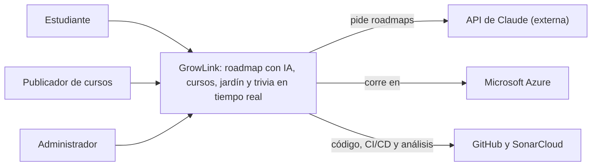
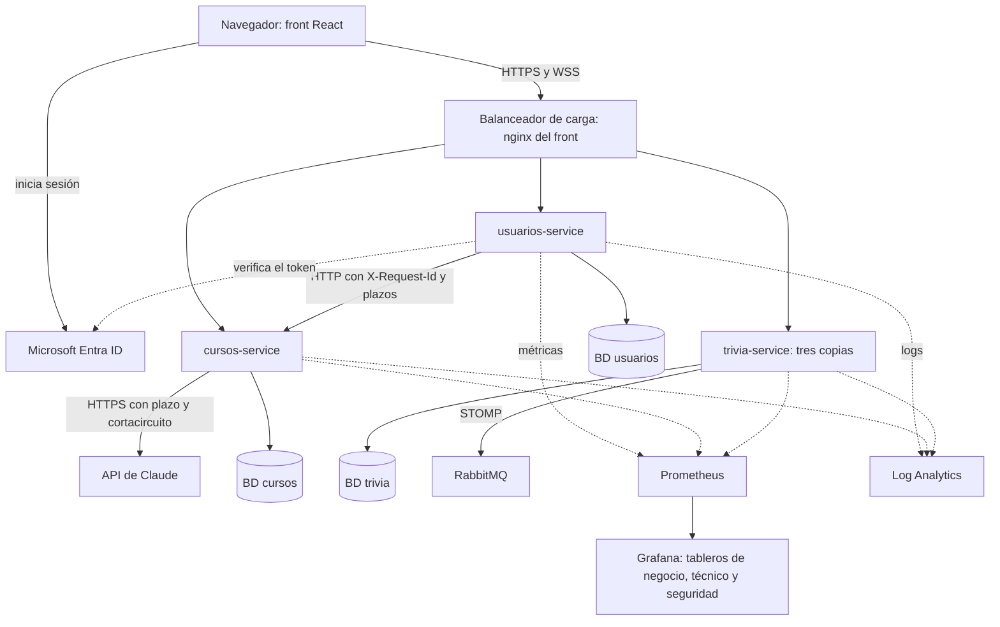
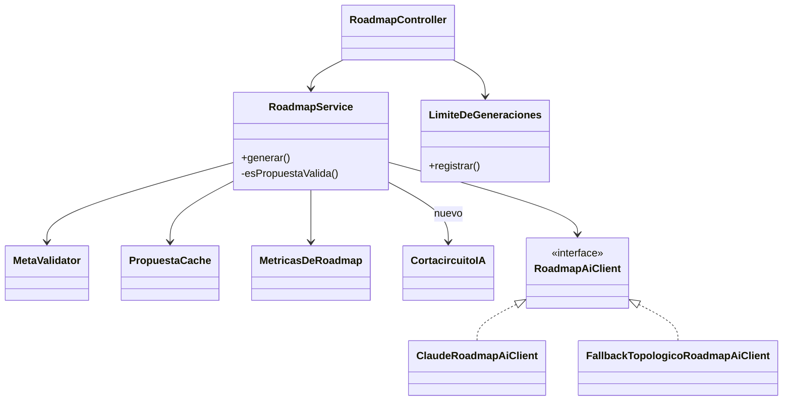
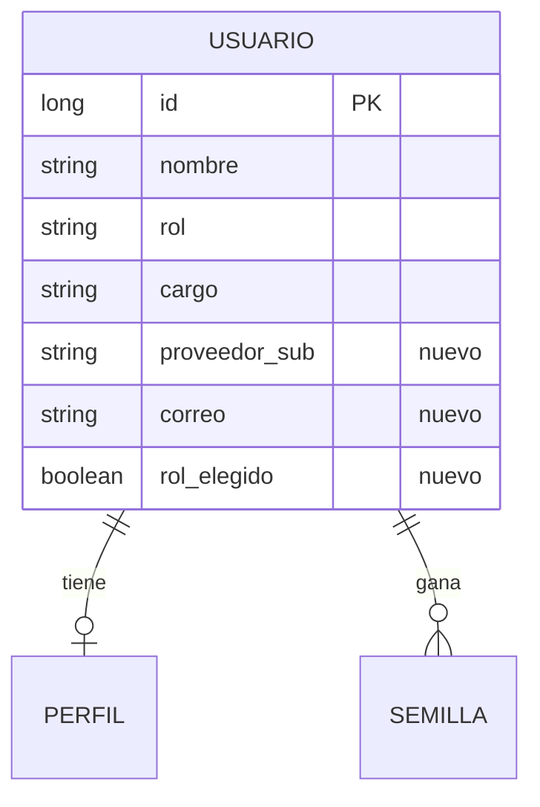
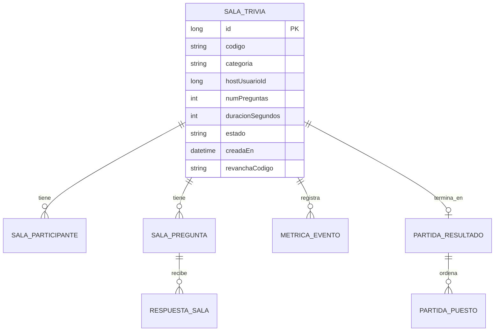
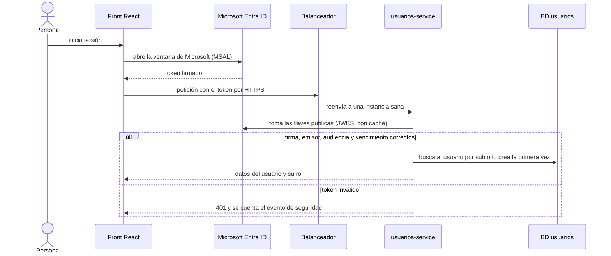
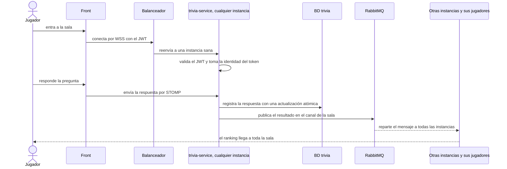
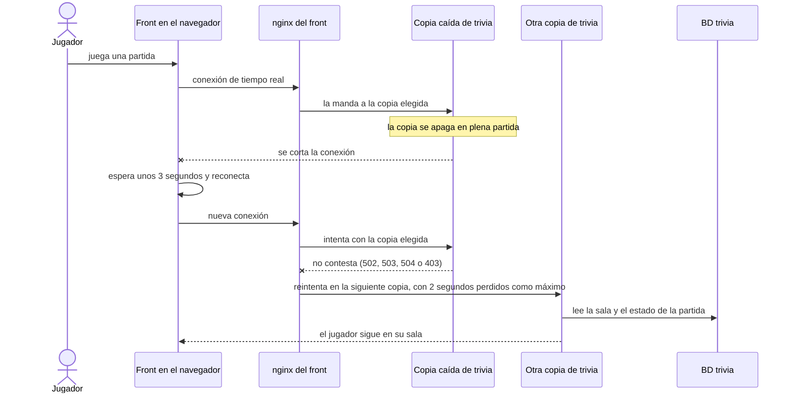
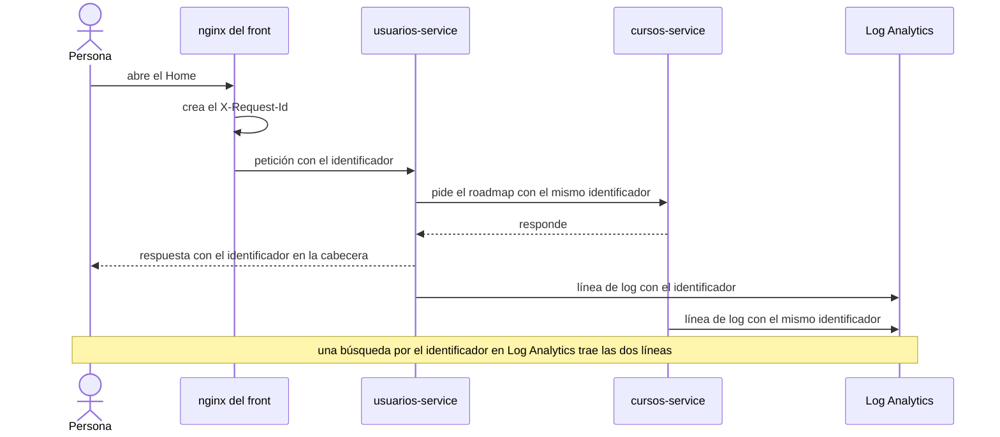
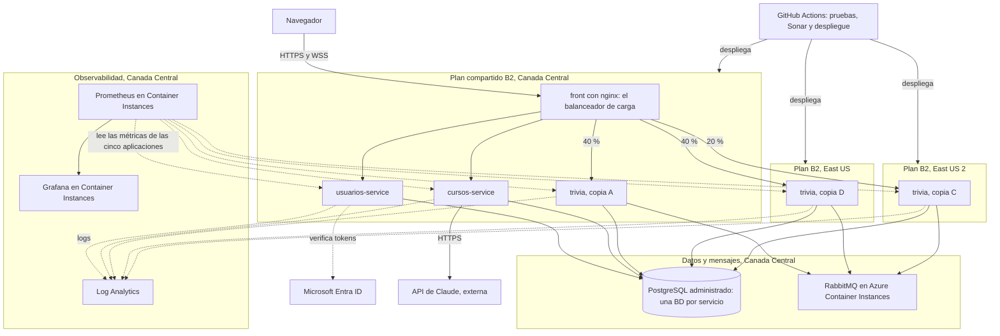

# Diagramas de arquitectura de GrowLink

Copia en el repositorio de la sección 6 del documento de arquitectura (Sprint 2), actualizada el 16 de noviembre de 2026. El documento principal está en Claude Docs; aquí quedan los diagramas en formato Mermaid para que GitHub los dibuje y se puedan versionar.

Son diez diagramas: contexto, componentes, clases, dos de entidad-relación (usuarios y trivia), cuatro de secuencia y uno de despliegue. Lo que dice "nuevo" es lo que agregamos en este sprint.

## 6.1 Diagrama de contexto

Quién usa GrowLink y con qué sistemas externos se habla.

## 6.2 Diagrama de componentes

Las piezas del sistema y quién habla con quién. El balanceador de carga es el nginx del front. Las líneas punteadas son las métricas, los logs y la verificación del token.

## 6.3 Diagrama de clases: módulo de roadmap

`RoadmapAiClient` es una interfaz con dos implementaciones: la IA real y el algoritmo de respaldo (es el patrón Strategy). Así podemos cambiar de una a otra sin tocar `RoadmapService`, y eso es lo que hace posible el escenario D2.

## 6.4 Diagramas entidad-relación

Cada servicio tiene su propia base de datos y no hay llaves foráneas entre servicios: cursos y trivia guardan el `usuarioId` como un número (ADR-0001). Lo marcado como "nuevo" es lo que agrega el login con Microsoft (el identificador de la persona en el proveedor, su correo y si ya eligió su rol). Mostramos usuarios y trivia; cursos no cambia en este sprint.

**usuarios-service**

**trivia-service**

## 6.5 Diagramas de secuencia

**Entrar con Microsoft (S1).** Cómo se obtiene el token, cómo lo verifica el servicio y qué pasa cuando no es válido.

**Responder en una trivia (****S1 y P1).** Por qué todos ven el mismo ranking aunque estén conectados a instancias distintas.

**Se cae una copia de trivia en plena partida (D1).** Qué hace el balanceador y qué hace el jugador cuando una de las copias deja de contestar.

**Seguir una petición por todos los servicios (O2).** Cómo un solo identificador junta las líneas de log de usuarios y cursos.

## 6.6 Diagrama de despliegue

**Cómo quedó desplegado en Azure (grupo de recursos rg-growlink).** El front con su nginx, usuarios, cursos y la copia A de trivia comparten un plan B2 en Canada Central. La copia D y la copia C de trivia tienen cada una su propio plan B2, en East US y en East US 2. La base de datos PostgreSQL, RabbitMQ, Prometheus y Grafana están en Canada Central. Ningún componente comparte servidor con todos los demás, y apagar una copia de trivia no corta el servicio. La opción B (máquinas virtuales) no se construyó, por eso no la dibujamos.

